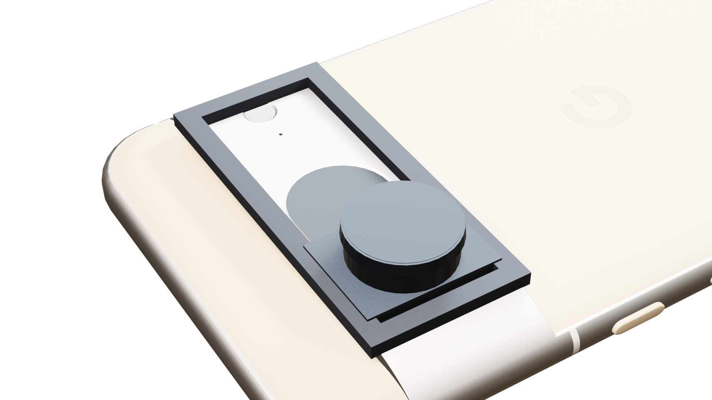
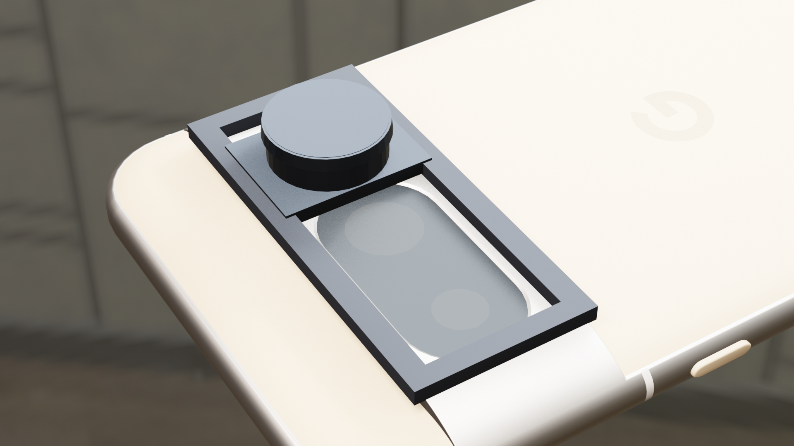
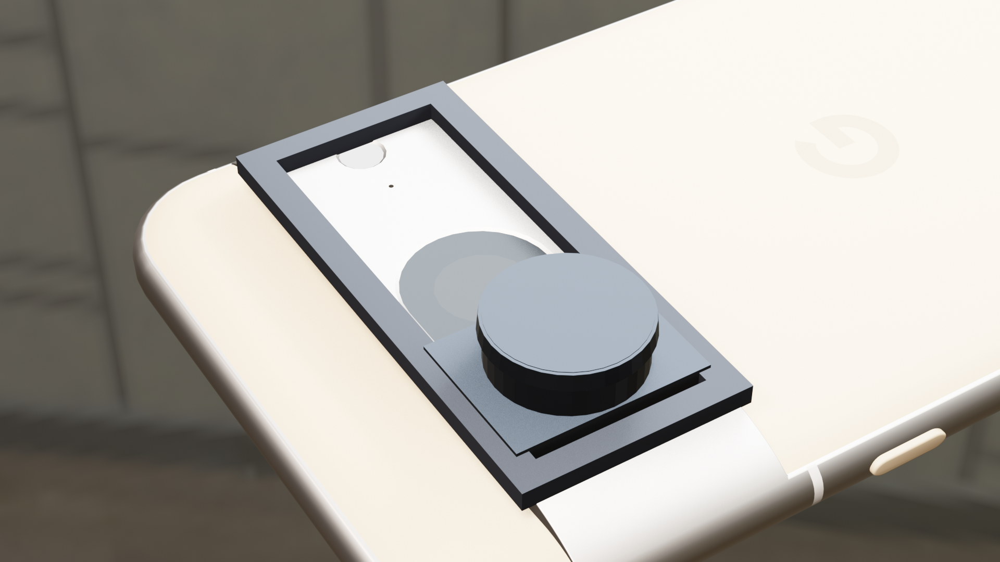

# 📷 Pixel 8 "Visor-Glide" Hot-Swappable Telephoto Slider

[](https://opensource.org/licenses/MIT)
[](cad/)
[](docs/PRINTING_GUIDE.md)
[](https://store.google.com/product/pixel_8)

An open-source mechanical hardware mod and rail system engineered specifically for the **Google Pixel 8**. It turns the iconic camera "visor" into a precision sliding track, adding a **hot-swappable 2x optical telephoto lens** with zero setup time.

Flick to engage true optical zoom. Flick back to stow. No screw threads, no clumsy clips, and no missing moments.

---

## 🌟 Interactive 3D Simulator

Experience the mechanism, test the slide stroke, and inspect mesh clearances in full 3D:

👉 **[Launch Interactive 3D Web Simulator](https://sanshray.github.io/pixel8-telephoto-slider/)** *(or run locally from `web-simulator/index.html`)*



---

## 🎯 The Motivation

The base **Google Pixel 8** features an industry-leading 50MP 1/1.31" main sensor and a 12MP ultrawide camera, but **lacks a physical optical telephoto lens** (which Google reserved exclusively for the 8 Pro). While digital crop works passably at 2x, zooming further results in digital artifacting, loss of fine texture, and artificial bokeh rendering.

Third-party add-on lenses (Moment, Sandmarc, Apexel) provide real glass compression, but traditional mounting systems are painful:
* **Screw-on mounts:** Take 30–60 seconds to thread on; you miss the action.
* **Spring clips:** Hard to center by hand, slip easily, and risk scratching the phone glass.
* **Storage friction:** Lenses end up forgotten in bags or pockets.

### Why the Pixel Visor is the Perfect Solution
Unlike iPhones or Samsung Galaxy phones with asymmetrical corner bumps, the Pixel camera visor extends edge-to-edge horizontally across the chassis. It acts as an **integrated structural guide rail**. 

---

## ⚙️ How It Works

The **Visor-Glide** assembly consists of two interlocking parts designed around exact 3D laser-scan CAD tolerances:

| Mode | Visual | Description |
| :--- | :---: | :--- |
| **Parked Mode** (0 mm) |  | The lens carriage sits parked safely in the **19.4 mm clear zone** between the camera glass pill and the LED flash. Main camera, ultrawide camera, LDAF laser autofocus, and microphones remain 100% unobstructed. |
| **Active Telephoto Mode** (28 mm) |  | With a flick of the finger, the carriage glides **28.0 mm horizontally** and snaps dead-center over the 50MP Main sensor, delivering true optical 2x magnification with natural shallow depth-of-field. |

---

## 📐 Engineering & CAD Specifications

Extracted directly from the Pixel 8 chassis geometry:

| Specification | Dimension / Value | Engineering Context |
| :--- | :--- | :--- |
| **Slide Travel Stroke** | **28.0 mm** | Linear travel between stowed park and main camera optical center |
| **Visor Protrusion** | **+2.81 mm** | Height above back glass; provides upper & lower anchor lips |
| **Visor Bar Height** | **22.2 mm** | Vertical envelope accommodating dual C-channel guide rails |
| **Clearance Gap** | **19.4 mm** | Flat unpopulated visor zone between camera pill and flash/mic |
| **Optic Barrel Bore** | **Ø 15.6 mm** | Designed for standard 2x–2.5x auxiliary smartphone lens cores |
| **Glass Air Gap** | **0.5 mm** | Micro-gap preventing any mechanical contact with camera glass |
| **Detents** | Dual Magnetic / Snap | Tactile positive clicks at 0.0mm and 28.0mm positions |

---

## 🗂️ Repository Structure

```text
├── cad/
│   ├── stl/
│   │   ├── pixel8_visor_rail.stl         # Snap-on visor rail chassis
│   │   └── pixel8_lens_carriage.stl      # Sliding carriage with Ø15.6mm lens barrel
│   ├── blender/
│   │   └── pixel8_camera_slider_assembly.blend  # Complete CAD assembly & render scene
│   └── models/
│       └── pixel8_slider_assembly.glb    # Lightweight glTF 2.0 assembly model
├── docs/
│   ├── ASSEMBLY.md                       # Step-by-step assembly & mounting guide
│   ├── BOM.md                            # Complete Bill of Materials & sourcing links
│   └── PRINTING_GUIDE.md                 # Slicer settings, materials (Resin vs PETG)
├── media/                                # High-resolution studio 3D renders
├── web-simulator/                        # Standalone Three.js 3D interactive viewer
├── .github/workflows/pages.yml           # Automated GitHub Pages deployment
├── LICENSE                               # MIT Open Source License
└── README.md
```

---

## 🚀 Quick Start & Making Your Own

### 1. 3D Print the Parts
* Read the [3D Printing Guide](docs/PRINTING_GUIDE.md) for slicer orientation and tolerance tips.
* **Recommended Material:** SLA Resin (ABS-like or Tough Resin) for friction-free sliding surfaces, or PETG / ASA with a 0.2mm or 0.4mm nozzle.
* Files ready to slice in `cad/stl/`.

### 2. Source the Optics & Hardware
* Refer to the [Bill of Materials (BOM)](docs/BOM.md).
* Core optic: Harvest a 2x/2.5x auxiliary telephoto glass core (e.g., Apexel 85mm portrait core or Moment 58mm lens module).
* 2x N52 miniature neodymium magnets (Ø 1.5mm × 1mm or 2mm × 1mm) for magnetic position detents.

### 3. Assembly
* Follow the step-by-step [Assembly Guide](docs/ASSEMBLY.md) to install felt buffer pads, press-fit the lens barrel, and mount the rail to your phone.

---

## 🔬 Optical Performance & Results

* **Sensor Utilization:** Aligns with Google's 1/1.31" 50MP ISOCELL GNV sensor (25mm equivalent primary).
* **Effective Focal Length:** With a 2x optical element, effective focal length shifts from **25mm to ~50mm–58mm**, providing classic portrait perspective compression without digital crop blur.
* **Software Compatibility:** Fully compatible with Google Camera (GCam) in standard photo, RAW, and Portrait modes.

---

## 🤝 Contributing

Community contributions are welcome! Ongoing areas of exploration:
- [ ] Alternative carriage designs for **anamorphic** and **macro** optical elements.
- [ ] Integrated snap-on phone case version (single unibody piece enclosing the phone).
- [ ] Spring-ball flexure detents eliminating the need for magnets.

Feel free to open an [Issue](https://github.com/issues) or submit a Pull Request.

---

## 📄 License

This project is open-source hardware licensed under the [MIT License](LICENSE). You are free to modify, 3D print, and distribute it.
